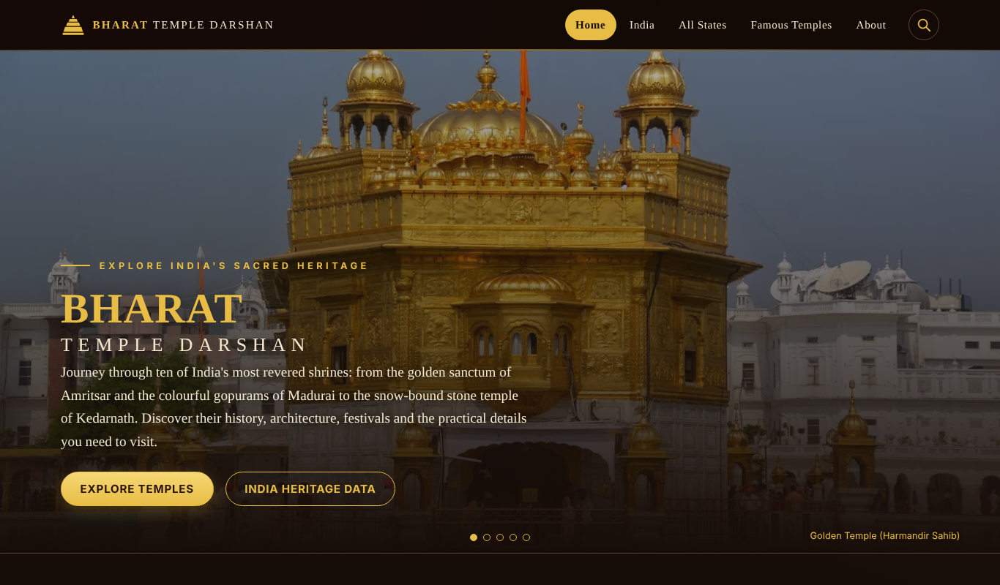

# BHARAT TEMPLE DARSHAN - Explore India's Sacred Heritage

A B.Tech college project: a Flask + JavaScript website for ten celebrated Indian temples, with an explorer for the original Indian Heritage CSV datasets.



## Features
- Ten separate temple pages (`/temple/<slug>`): hero photo, location, deity, **documented history kept separate from tradition**, architecture, significance, festivals, visitor information, gallery, location map, related temples and a back button.
- **649 real photographs** from your `archive.zip`, optimized to WebP (thumbnail + large), lazy-loaded, with a full-screen viewer (next/previous, keyboard arrows, touch swipe, swipe-down to close). Every temple page only ever uses its own folder's images.
- Live search (header icon, home page, Famous Temples page) by temple, city, state, deity or alias, with a no-results message and a Clear button.
- State filter (server-side) on the home page and the Famous Temples page; `/states` lists all 36 states and union territories from your tourism file; `/states/<state>` shows temples, monuments, heritage sites, museums, art and tourism for that state.
- **India Heritage Explorer** (`/india`): map (heritage coordinates + the 10 temples), searchable/filterable Monuments, Cultural Heritage, Museums and Art & Artists, and a Tourism bar chart + sortable table.
- Responsive dark-brown / gold / maroon design, mobile menu, browser back/forward, loading indicators, clear error pages.

## Quick start
Requires Python 3.9+.
```bash
cd bharat-temple-darshan
python -m venv venv
source venv/bin/activate          # Windows: venv\Scripts\activate
pip install -r requirements.txt
python app.py
```
Open http://localhost:5000

There is no separate frontend build step: the frontend is plain HTML/CSS/JS served by Flask, so one command runs everything. (The brief suggested React/Vite as an option; a no-build frontend was chosen so the project installs with a single dependency, Flask, and runs anywhere.)

## Project structure
```
bharat-temple-darshan/
  app.py                 Flask server + JSON API
  requirements.txt       Flask only
  templates/index.html   Single-page app shell
  static/
    css/main.css         Theme and layout
    js/app.js            Router, search, pages, gallery, lightbox, charts, map
    img/temples/<slug>/  Optimized photos (NNN.webp, tNNN.webp thumbnails)
  data/
    temples.json         Temple content (history, architecture, festivals, visit info)
    gallery_manifest.json  Photo list per temple
    monuments_data.csv, cultural_heritage.csv, museum_data.csv,
    tourism_data.csv, art_data.csv   Your original datasets, unchanged
  tests/e2e_test.py      Browser test (Playwright)
  tools/                 Scripts used to build the optimized gallery from archive.zip
  docs/                  Screenshots
  original-streamlit-app/  Your original Streamlit app.py, kept for reference
```

## API
`/api/temples?q=&state=` `/api/temples/<slug>` `/api/search?q=` `/api/states` `/api/states/<slug>` `/api/datasets/<monuments|heritage|museums|art>?q=&state=&type=&page=` `/api/tourism` `/api/map` `/api/stats`

## Image-to-temple mapping
| Folder in archive.zip | Route | Photos used |
|---|---|---|
| Tirumala Tirupati Venkateswara Temple | /temple/tirumala-venkateswara | 70 |
| Meenakshi Amman Temple | /temple/meenakshi-amman | 83 |
| Shri Jagannath Temple | /temple/jagannath | 55 |
| Amarnath Cave Temple | /temple/amarnath | 57 |
| Golden Temple | /temple/golden-temple | 84 |
| Kedarnath Temple | /temple/kedarnath | 81 |
| Kashi Vishwanath Temple | /temple/kashi-vishwanath | 26 |
| Sabarimala Ayyappa Temple | /temple/sabarimala | 72 |
| Shri Shirdi Sai Baba Temple | /temple/shirdi-sai-baba | 62 |
| Mumbai Siddhivinayak Temple | /temple/siddhivinayak | 59 |

The folders hold 904 files; 255 were left out of the galleries: near-duplicates, photos with advertising/watermark overlays, collages, maps, and photos showing a different building. Notably, many files in the Kashi Vishwanath folder show the separate Vishwanath Temple at Banaras Hindu University (and a Thanjavur temple), so only photos of the Kashi Vishwanath complex are used. Your original files are untouched. To rebuild the gallery, extract `archive.zip`, point `tools/analyze_images.py` at it and run `tools/build_gallery.py` (needs Pillow).

## 360-degree viewer
The collection contains individual photographs, not consecutive frame sequences, so **no 360-degree viewer is shown** (as your brief requires). The hero photo has a subtle hover zoom, labelled as an effect.

## Testing
```bash
pip install playwright && playwright install chromium
python app.py &            # in another terminal
python tests/e2e_test.py
```
The test checks every nav link, search, no-results, state filters, all ten temple pages (sections, 3 related temples, image isolation, no broken thumbnails, no horizontal scroll), the lightbox (buttons, keys, touch swipe), back/forward, all datasets and counts, tourism chart/table, 404 pages, and browser console errors, on a desktop and an iPhone-sized viewport.

## Content and data notes (please read before submitting)
- Temple text was written from standard references and separates documented history from tradition. **Verify dates and facts you plan to cite** and add your references in the report; timings, fees and rules change, so each page links to the official site (confirm those URLs open).
- `tourism_data.csv` is shown exactly as supplied. It has no year for domestic arrivals and some values look unusual (e.g. Goa domestic 0.82 M); a data note is shown beside the charts.
- A few photographs may still carry small stock-photo watermarks that were hard to see at thumbnail size (e.g. an "alamy" mark on some Kedarnath photos). Check them if you need clean images.
- The map is a schematic outline for orientation, not an official boundary map.
